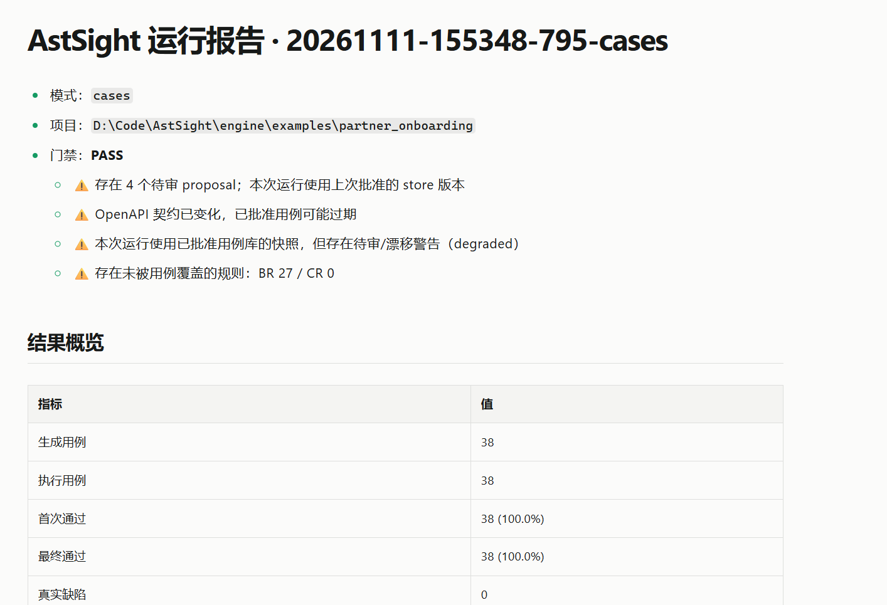

# AstSight

**把需求文档和代码变更加工成可执行、可审核、可追溯的 API 用例。**

AstSight 是一套接口自动化测试引擎：输入需求/设计文档、OpenAPI 契约、代码仓库与数据库结构，
输出规则库、版本化用例库、pytest 脚本和执行报告。它不做用户管理、用例管理 UI 或任务调度。

## 为什么是 AstSight，而不是「pytest + 一个 LLM」

现在让 LLM 直接生成测试用例已经不难。难的是**生成物出错时能不能被抓住**。AstSight 的回答是：

- **模型只出候选，不直接改结论**——规则和用例都经框架校验后入库，模型幻觉在落库前被拦截；
- **规则是唯一事实源**——用例从规则派生，冲突在规则层就暴露，而不是散落在几百条用例里；
- **人工审核是硬门禁**——批准必须由真实审核人执行，框架不会自动批准。

所以它要解决的，不是"能不能生成用例"，而是"AI 生成的用例，出错了能被定位、被追溯、被拦截吗"。

```text
需求/设计/OpenAPI ──► 规则库 ──► 用例草案 ──► 人工审核 ──► 用例库
                                                    │
代码变更 ──► 受影响接口与画像 ───────────────────────┤
                                                    ▼
                                    造数计划 → pytest → 执行报告
```

> 目前断言以 L1（状态码 / 字段存在 / 字段值）为主，L2–L4 业务不变量断言在
> [路线图](ROADMAP.md)上。我们把「尚未实现」写清楚，而不是藏起来——这是刻意的诚实。

这是一份真实运行报告（示例项目 [partner_onboarding](engine/examples/partner_onboarding)，
38 个用例全部通过、门禁 PASS）：



## 核心能力

| 能力 | 说明 |
|---|---|
| 需求驱动规则 | 需求/设计文档 + OpenAPI → 业务规则（BR）+ 契约规则（CR） |
| 规则驱动用例 | 规则 + 接口画像 + Mock 语义 + 数据目录 → 可校验的用例草案 |
| 人工审核与版本化 | 提案逐条审批，`TC-NNNN` 编号永不复用，旧版本进入 history |
| 多请求用例 | `steps[]` 顺序请求与跨步骤引用，覆盖频控、验证码、幂等重试 |
| Mock 与造数 | 下游明文 HTTP Mock、C5a 数据目录、C5b 逐用例造数（SQLite / PostgreSQL / MySQL） |
| 三种运行范围 | `full` 建基线、`delta` 按代码变更重判、`cases` 只执行已批准用例 |
| 证据化报告 | 通过/失败之外，未映射范围、未执行用例、待审提案、规则漂移单列 |

## 环境要求

- Python 3.11 及以上（仓库最近在 3.13 验证）。
- 目标运行环境为 Linux（服务器 / CI）；Windows 可用于本地调试。
- 被测服务（SUT）需要可访问的 HTTP 地址；不提供时只生成、不执行。
- 非 Python 项目需要 CodeGraph（Node >= 22.5，可选）。

## 安装

```bash
cd engine
pip install -r requirements.txt

# 源码目录运行时把 engine/ 加入 PYTHONPATH
PYTHONPATH=. python -m astsight --help
```

非 Python 项目额外安装代码图谱运行时（用户级缓存，所有项目复用）：

```bash
PYTHONPATH=. python -m astsight codegraph install
PYTHONPATH=. python -m astsight codegraph status
```

## 配置大模型

模型用于规则抽取、用例设计和语义补全，是可选能力；不配模型也可以只用确定性链路。

```bash
cd engine
cp llm.example.json llm.json
export ASTSIGHT_LLM_API_KEY=你的key
```

`llm.example.json` 是可直接使用的模板，支持 `provider`（`anthropic` / `openai`）、
`model`、`base_url`、`auth_style`、`api_key_env` 和调用参数。密钥建议只放环境变量，
`llm.json` 已加入 `.gitignore`。

配置查找顺序：`--llm-config PATH` → `ASTSIGHT_LLM_CONFIG` → `./llm.json` →
`~/.astsight/llm.json`；环境变量 `ASTSIGHT_LLM_*` 始终覆盖文件值。

三种常见写法见 [快速上手指南](doc/AstSight-快速上手指南.md#42-三种常见配置)。
配好后用 `rules extract`（别名 `rules c1`）验证连通。

## 5 分钟上手

```bash
cd engine

# 代码变更 → 接口画像 → 用例 → pytest → 报告（不需要模型）
python examples/demo_delta.py

# 需求 → 用例 → 人工审核 → 版本化 → 执行（不需要模型）
python examples/demo_case_review.py

# 规则 → Mock 语义 → 造数 → 用例 → 计划 → 执行（需要模型）
python examples/demo_agent_flow.py --keep
```

demo 会自动启动示例服务，产物在临时目录的 `.astsight/runs/<run_id>/`，先看 `report.md`。

完整示例项目：[engine/examples/partner_onboarding](engine/examples/partner_onboarding/README.md)
（设计 V1.1，38 条已批准用例全部通过）。

## 在你的项目上使用

### 方式一：一条命令（需要模型）

```bash
cd engine
PYTHONPATH=. python -m astsight agent run \
  --project /path/to/project \
  --requirements /path/to/project/docs/requirements.md \
  --base-url http://127.0.0.1:8010 \
  --sut-command "python -m uvicorn app:app --port 8010"
```

依次完成规则抽取、Mock 语义、数据目录、用例设计、待审提案、造数计划、
启动 Mock 与 SUT、pytest、失败诊断。不加 `--approve-as` 时停在待审提案，等人工审核。

### 方式二：分步执行（便于审核和排错）

```bash
cd engine

# 1. 需求 → 规则库
PYTHONPATH=. python -m astsight rules c1 \
  --project /path/to/project \
  --requirements /path/to/project/docs/requirements.md \
  --design /path/to/project/docs/design.md \
  --openapi /path/to/project/openapi.json

# 2. 生成用例上下文（按 prompts/a4_case_design.md 写出 cases.draft.json）
PYTHONPATH=. python -m astsight cases prepare \
  --project /path/to/project \
  --requirements /path/to/project/docs/requirements.md \
  --openapi /path/to/project/openapi.json

# 3. 导入为待审提案（不改用例库）
PYTHONPATH=. python -m astsight cases import \
  --project /path/to/project \
  --context /path/to/project/.astsight/casegen/<context_id> \
  --draft /path/to/project/cases.draft.json \
  --ruleset /path/to/project/ruleset.json

# 4. 人工审核（a=approve / r=reject / s=跳过 / q=保存退出）
PYTHONPATH=. python -m astsight cases review \
  --proposal /path/to/project/.astsight/cases/proposals/<proposal_id> --pending

# 5. 由审核人批准入用例库
PYTHONPATH=. python -m astsight cases approve \
  --project /path/to/project \
  --proposal /path/to/project/.astsight/cases/proposals/<proposal_id> \
  --reviewer <审核人>

# 6. 造数计划（有前置状态用例时需要）
PYTHONPATH=. python -m astsight data catalog --project /path/to/project \
  --ddl /path/to/project/schema.sql
PYTHONPATH=. python -m astsight data plan --project /path/to/project \
  --catalog /path/to/project/.astsight/data/data_catalog.json \
  --cases /path/to/project/caseset.json \
  --ruleset /path/to/project/ruleset.json

# 7. 执行已批准用例
PYTHONPATH=. python -m astsight run --project /path/to/project --mode cases \
  --base-url http://127.0.0.1:8010 \
  --reset-url http://127.0.0.1:8010/_reset \
  --data-plan /path/to/project/.astsight/data/data_plan.json
```

### 方式三：已有用例库，按代码变更执行

```bash
PYTHONPATH=. python -m astsight run \
  --project /path/to/service-repo \
  --mode delta --base main --target HEAD \
  --base-url http://127.0.0.1:8010 \
  --openapi /path/to/service-repo/openapi.json
```

`--project` 必须是 git 仓库根（delta 需要执行 `git diff`）。

## 产物在哪

| 产物 | 默认位置 |
|---|---|
| 规则库 | `<project>/ruleset.json`、`ruleset.md` |
| 规则/用例上下文 | `<project>/.astsight/rules/`、`.astsight/casegen/` |
| 待审提案 | `<project>/.astsight/cases/proposals/` |
| 用例库 | `<project>/caseset.json` |
| 数据目录与造数计划 | `<project>/.astsight/data/` |
| 运行产物与报告 | `<project>/.astsight/runs/<run_id>/` |

门禁结论来自确定性信号：契约漂移、待审提案、用例通过率、未映射变更、规则覆盖率等。

**静默通过是最大风险**：未覆盖范围、未执行用例、待审提案和规则漂移都会在报告中单列。

## 文档

面向使用者：

- [快速上手指南](doc/AstSight-快速上手指南.md)：30 分钟跑 demo、配置模型、三条使用路线
- [使用文档](doc/AstSight-使用文档.md)：完整参数、流程、产物、门禁与排错
- [C1 规则生成使用文档](doc/C1-规则生成使用文档.md)：规则抽取与两段式流程
- [引擎实现说明](engine/README.md)：模块划分、实现进度与内部约定

设计与决策（维护者参考）：

- [能力设计](doc/framework-capability-design.md)
- [Agent 架构](doc/agent-architecture.md)
- [CodeGraph 集成设计](doc/CodeGraph-集成设计.md)
- [决策记录](doc/决策记录.md)

## 当前状态与边界

当前版本是规则驱动的确定性闭环：规则库、两级用例、Mock 语义、C5a/C5b 造数、
pytest 生成与执行、`agent run` 编排均已落地，示例项目 38 条用例全部通过。
主要边界：

- 断言以 L1 为主（状态码、字段存在、字段值）；更强的业务不变量断言尚未完整落地。
- 造数支持 SQLite / PostgreSQL / MySQL；三者共用同一套 fixture 校验与事务语义，
  驱动分别为 stdlib `sqlite3`、`psycopg`、`PyMySQL`。
- HTTP 是主路径；gRPC 仅 unary、Dubbo 2.7+ 通过 sidecar，Mock 实现仍在推进。
- 时间窗口恢复、真实并发、外部配置切换等场景需要时钟注入或专用测试接口，
  当前以“连续请求立即命中”近似，并在报告中显式标注。
- 审核必须人工完成；`deprecate` 不会自动批准。
