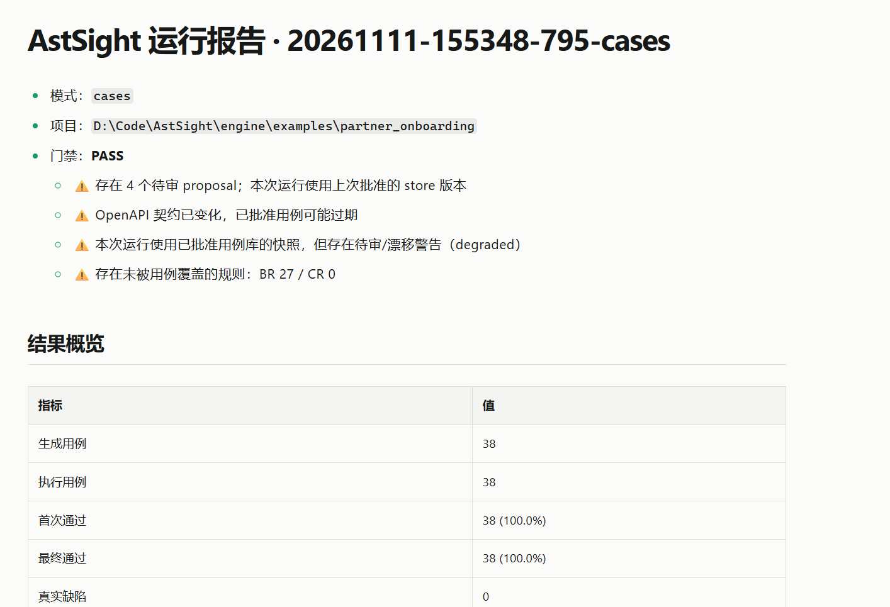

# AstSight

**把需求文档和代码变更加工成可执行、可审核、可追溯的 API 用例。**

AstSight 是一套接口自动化测试引擎：输入需求/设计文档、HTTP/gRPC/Dubbo 契约、代码仓库与数据库结构，
输出规则库、版本化用例库、pytest 脚本和执行报告。它不做用户管理、用例管理 UI 或任务调度。

## 它和「pytest + 一个 LLM」差在哪

现在让 LLM 写用例已经不难。难的是四件事：**生成物错了能不能拦住、业务规则变了能不能找到影响面、测试数据能不能自己造、失败后能不能定位**。

| 常见做法 | 问题 | AstSight 的做法 |
|---|---|---|
| LLM 直接写用例，跑通就入库 | 幻觉没有门禁 | 模型只出候选；规则、契约、画像逐项校验，人工审核是硬门禁 |
| 业务规则散落在用例和注释里 | 规则一变，不知道哪些用例受影响 | 规则是唯一事实源；用例从规则派生，冲突和漂移单列 |
| 造数靠环境里现成的数据 | 换套环境就挂，或者跑出假失败 | 前置数据插表构造（主表/关联表一起插），下游数据由 Mock 构造 |
| 失败只能看日志猜 | 修错地方，或者把假失败当缺陷 | 保留 Mock/造数/执行证据，先归因再有界修复，修补留痕 |

**测试数据只有两个来源**：本服务数据库由框架插入用例声明的数据，下游服务由 Mock 返回用例声明的数据。不调业务接口造前置数据，不依赖环境里碰巧存在的真实记录——用例自己造出来的数据，才是可复现的数据。

所以 AstSight 要解决的不是"能不能生成用例"，而是"AI 生成的用例，出错了能被定位、被追溯、被拦截吗"。

```text
需求/设计/OpenAPI ──► 规则库 ──► 用例草案 ──► 人工审核 ──► 用例库
                                                    │
代码变更 ──► 受影响接口与画像 ───────────────────────┤
                                                    ▼
                                    造数计划 → pytest → 执行报告
```

> 目前支持状态码、响应字段、header、OpenAPI 响应 schema 和只读数据库行断言；
> 强度 L1–L4 按内容自动推导。关系断言可引用当前响应字段、更早步骤响应并执行受限聚合
> 与算术（`len/sum/avg/min/max/count_distinct/pluck/...`），
> `db_row.wait_ms` 支持异步落库轮询，规则中显式声明的结构化关系（含跨步骤语义引用）
> 会由框架自动物化；
> 尚不能从任意自然语言自动推导复杂业务公式——
> 剩余边界列在[路线图](ROADMAP.md)上。我们把「尚未实现」写清楚，而不是藏起来——
> 这是刻意的诚实。

这是一份真实运行报告（示例项目 [partner_onboarding](engine/examples/partner_onboarding)，
38 个用例全部通过、门禁 PASS）：



## 核心能力

| 能力 | 说明 |
|---|---|
| 需求驱动规则 | 需求/设计文档 + 四类契约源 → 业务规则（BR）+ 按源能力子集生成的 CR |
| 规则驱动用例 | 规则 + 接口画像 + Mock 语义 + 数据目录 → 可校验的用例草案 |
| 人工审核与版本化 | 提案逐条审批，`TC-NNNN` 编号永不复用，旧版本进入 history |
| 多请求用例 | `steps[]` 顺序请求与跨步骤引用，覆盖频控、验证码、幂等重试 |
| Mock 与造数 | 用例实体 `data` 驱动：本服务插表造数（含关联表），下游 Mock 返回同一实体；支持 HTTP/Dubbo/gRPC 下游，不调接口造数；Kafka 生产者侧消息拦截，不连 broker |
| MQ 消息断言 | Java agent 截获 Kafka/RabbitMQ/RocketMQ 生产者消息；Python SUT 通过 sitecustomize 拦截 kafka-python/pika；不真正发送，断言 topic/key/headers/payload/条数；topic 支持字面量、常量与 Spring `@Value`/配置键解析 |
| 多语言下游契约 | Java/Go/Node 出站调用点识别；Java 可读 pom/gradle 与本地 jar，提取 DTO 字段和泛型签名，识别 Feign 调用并解析响应契约 |
| 三种运行范围 | `full` 建基线、`delta` 按代码变更重判、`cases` 只执行已批准用例 |
| 变更感知 | 代码 diff、route-level 删除接口（对应用例自动逻辑删除）、HTTP/gRPC/Dubbo 契约 diff（参数/字段/方法/枚举/streaming） |
| 证据化报告 | 通过/失败之外，未映射范围、未执行用例、待审提案、规则漂移单列 |

## 环境要求

- Python 3.11 及以上（CI 使用 3.12；本地最近在 3.13 验证）。
- 默认主路径需要大模型；安装后执行 `astsight init` 生成配置。
- 目标运行环境为 Linux（服务器 / CI）；Windows 可用于本地调试。
- 被测服务（SUT）需要可访问的 HTTP 地址；不提供时只生成、不执行。
- CodeGraph 由平台 wheel `astsight-codegraph-bin` 内置（含 Node 运行时），
  不需要用户另装 Node/npm。

## 安装

```bash
pip install astsight
astsight init
astsight --help
```

支持的平台是 Linux x86_64/arm64、macOS x86_64/arm64、Windows x86_64；
CodeGraph 的平台 wheel 会随主包自动安装。

源码开发：

```bash
cd engine
pip install -e ".[dev]"
```

`dev` extra 包含 pytest、langgraph（编排骨架测试用）以及 PostgreSQL/MySQL 驱动；
默认安装不包含这些。

### CodeGraph

CodeGraph 用于 `delta` 的“内部方法变更 → 受影响接口”追溯。默认安装已经带上
平台 wheel `astsight-codegraph-bin`，内含固定版本 CodeGraph 与 Node 运行时；
支持的平台是 Linux x86_64/arm64、macOS x86_64/arm64、Windows x86_64。

```bash
astsight codegraph status
```

`status` 显示 `source=packaged` 时，Node 与 CodeGraph 都来自 wheel，无需系统 Node。
其他平台或开发/离线环境可回退到 `astsight codegraph install` 安装到用户缓存。

## 配置大模型

默认主路径（规则抽取、用例设计、`agent run`）需要模型。一条命令生成配置：

```bash
astsight init
export ASTSIGHT_LLM_API_KEY=你的key
```

`init` 会检测已有的 `ANTHROPIC_AUTH_TOKEN` / `ANTHROPIC_API_KEY` / `OPENAI_API_KEY`，
自动选择 provider、模型和 key 变量；没有检测到时生成 Anthropic 默认配置
（`claude-sonnet-5-5`），写入 `~/.astsight/llm.json`。交互式可修改 provider/model/base_url，
`--yes` 使用默认值，`--local` 写到当前目录。

配置文件只保存 key 的环境变量名，不写明文 key。查找顺序：
`--llm-config PATH` → `ASTSIGHT_LLM_CONFIG` → `./llm.json` → `~/.astsight/llm.json`；
环境变量 `ASTSIGHT_LLM_*` 始终覆盖文件值。`llm.example.json` 保留为字段参考。

三种常见写法见 [快速上手指南](doc/AstSight-快速上手指南.md#42-三种常见配置)。
配好后用 `rules extract`（别名 `rules c1`）验证连通。

## 5 分钟上手

> 下面的 demo 只在源码仓库的 `engine/examples/` 中；`pip install astsight`
> 不包含示例目录。

```bash
cd engine

# 配置模型（默认主路径；下面两个 demo 不需要模型）
astsight init

# 代码变更 → 接口画像 → 用例 → pytest → 报告（不需要模型）
python examples/demo_delta.py

# 需求 → 用例 → 人工审核 → 版本化 → 执行（不需要模型）
python examples/demo_case_review.py

# 规则 → Mock 语义 → 造数 → 用例 → 计划 → 执行（需要模型）
python examples/demo_agent_flow.py --keep
```

demo 会自动启动示例服务，产物在临时目录的 `.astsight/runs/<run_id>/`，先看 `report.md`。

遇到疑似框架自身的问题，`run` / `agent run` 在门禁失败时会自动生成脱敏诊断包；
也可以用 `feedback collect` 手动生成，再按 `feedback open` 给出的链接提交 GitHub Issue。
命令不会自动上传任何内容。

完整示例项目：[engine/examples/partner_onboarding](engine/examples/partner_onboarding/README.md)
（设计 V1.1，38 条已批准用例全部通过）。

## 在你的项目上使用

### 方式一：一条命令（需要模型）

```bash
astsight agent run \
  --project /path/to/project \
  --requirements /path/to/project/docs/requirements.md \
  --mode delta --base main --target HEAD \
  --base-url http://127.0.0.1:8010 \
  --sut-command "python -m uvicorn app:app --port 8010"
```

`agent run` 默认就是 delta，因此 `--project` 必须是 git 仓库根。
非 git 项目、或首次建全量基线时显式加 `--mode full`。

依次完成规则抽取、Mock 语义、数据目录、用例设计、待审提案、造数计划、
启动 Mock 与 SUT、pytest、失败诊断与修复。不加 `--approve-as` 时停在待审提案，
等人工审核；运行期修复默认最多 3 轮，用例补丁以 `astsight-agent:repair` 身份自动批准，
Mock 分支补丁直接热更新。

### 方式二：分步执行（便于审核和排错）

```bash
# 1. 需求 → 规则库
astsight rules c1 \
  --project /path/to/project \
  --requirements /path/to/project/docs/requirements.md \
  --design /path/to/project/docs/design.md \
  --openapi /path/to/project/openapi.json

# 2. 生成用例上下文（按 prompts/a4_case_design.md 写出 cases.draft.json）
astsight cases prepare \
  --project /path/to/project \
  --requirements /path/to/project/docs/requirements.md \
  --openapi /path/to/project/openapi.json

# 3. 导入为待审提案（不改用例库）
astsight cases import \
  --project /path/to/project \
  --context /path/to/project/.astsight/casegen/<context_id> \
  --draft /path/to/project/cases.draft.json \
  --ruleset /path/to/project/ruleset.json

# 4. 人工审核（a=approve / r=reject / s=跳过 / q=保存退出）
astsight cases review \
  --proposal /path/to/project/.astsight/cases/proposals/<proposal_id> --pending

# 5. 由审核人批准入用例库
astsight cases approve \
  --project /path/to/project \
  --proposal /path/to/project/.astsight/cases/proposals/<proposal_id> \
  --reviewer <审核人>

# 6. 造数计划（有前置状态用例时需要）
astsight data catalog --project /path/to/project \
  --ddl /path/to/project/schema.sql \
  --ruleset /path/to/project/ruleset.json \
  --code /path/to/project/src \
  --rule-states                              # 后两项可选：代码常量/跨表状态骨架
astsight data plan --project /path/to/project \
  --catalog /path/to/project/.astsight/data/data_catalog.json \
  --cases /path/to/project/caseset.json \
  --ruleset /path/to/project/ruleset.json

# 7. 执行已批准用例
astsight run --project /path/to/project --mode cases \
  --base-url http://127.0.0.1:8010 \
  --reset-url http://127.0.0.1:8010/_reset \
  --data-plan /path/to/project/.astsight/data/data_plan.json
```

### 方式三：已有基线，按代码变更做契约回归

```bash
astsight run \
  --project /path/to/service-repo \
  --mode delta --base main --target HEAD \
  --base-url http://127.0.0.1:8010 \
  --openapi /path/to/service-repo/openapi.json
```

`--project` 必须是 git 仓库根（delta 需要执行 `git diff`）。这条命令生成并执行
契约/模板用例，不读取已批准用例库；要执行审核通过的用例，用 `--mode cases`。

## 产物在哪

| 产物 | 默认位置 |
|---|---|
| 规则库 | `<project>/ruleset.json`、`ruleset.md` |
| 规则/用例上下文 | `<project>/.astsight/rules/`、`.astsight/casegen/` |
| 待审提案 | `<project>/.astsight/cases/proposals/` |
| 用例库 | `<project>/caseset.json` |
| 数据目录与造数计划 | `<project>/.astsight/data/` |
| 运行产物与报告 | `<project>/.astsight/runs/<run_id>/` |

门禁结论来自确定性信号：契约漂移、待审提案、用例通过率、未映射变更、规则覆盖率等。

**静默通过是最大风险**：未覆盖范围、未执行用例、待审提案和规则漂移都会在报告中单列。

## 文档

面向使用者：

- [快速上手指南](doc/AstSight-快速上手指南.md)：30 分钟跑 demo、配置模型、三条使用路线
- [使用文档](doc/AstSight-使用文档.md)：完整参数、流程、产物、门禁与排错
- [C1 规则生成使用文档](doc/C1-规则生成使用文档.md)：规则抽取与两段式流程
- [引擎实现说明](engine/README.md)：模块划分、实现进度与内部约定

设计与决策（维护者参考）：

- [能力设计](doc/framework-capability-design.md)
- [Agent 架构](doc/agent-architecture.md)
- [CodeGraph 集成设计](doc/CodeGraph-集成设计.md)
- [决策记录](doc/决策记录.md)

## 当前状态与边界

当前版本是规则驱动的确定性闭环：规则库、两级用例、Mock 语义、C5a/C5b 造数、
pytest 生成与执行、`agent run` 编排均已落地，示例项目 38 条用例全部通过。
主要边界：

- 断言覆盖状态码、响应字段、header、OpenAPI schema 和只读数据库行；L3/L4 关系断言
  支持 `$ref`、当前响应 `$field` 与受限聚合/算术；规则中明确声明的 relations 由框架
  自动物化。复杂自然语言公式仍不能可靠自动推导，用
  `tools/eval_relation_extraction.py` 跟踪抽取质量，而不是宣称“已解决”。
- 造数支持 SQLite / PostgreSQL / MySQL；三者共用同一套 fixture 校验与事务语义，
  驱动分别为 stdlib `sqlite3`、`psycopg`、`PyMySQL`。数据目录可从 DDL、DBML 或
  真实库反射生成（只读结构，不导出数据），多 schema 使用 `schema.table` 限定名；
  注释、DBML Enum note、规则常量与 Java/Python/Go/TS 枚举/常量组会先给出确定性的
  取值语义候选，每条带 `source`，证据固定为 `inferred`。
- HTTP 是主路径；gRPC 仅 unary。Dubbo 2.7+ 消费端 Mock 由 Java agent 的 Filter
  拦截，已在 Dubbo 2.7.22/3.2.19 × JDK 8/11/17/21/26 共 10 个组合验证；真实
  `ReferenceConfig` 代理在普通 classpath 与 Spring Boot fat jar 下都验证过桩
  返回与零建连；`agent run` 全链路（HTTP 入口 → Dubbo 下游，画像 → 计划 →
  自动注入 → 执行 → 报告）也已实测；调用被测 Dubbo 服务的一侧走 sidecar，
  Dubbo 3 `tri://` Java interface 与 Protobuf descriptor unary 均已实测。
- Java 下游契约只做只读静态解析：源码优先，依赖 jar 兜底；JDK 标量（String/数字/
  布尔）记为无字段契约并按类型生成 Mock body。动态代理、运行时注册中心地址解析
  不在此范围。
- 服务发现型下游（如 Feign `@FeignClient(name=...)`）使用 `discovery_override`：
  需要 SUT 使用 Spring Cloud LoadBalancer 并启用 `SimpleDiscoveryClient`，服务名
  按注册名精确匹配（区分大小写）；Nacos/Eureka 独占、Ribbon 或非 Spring 应用
  会在启动告警中显式标 `discovery_not_supported`，不假装成功。
- 时间窗口恢复、真实并发、外部配置切换等场景需要时钟注入或专用测试接口，
  当前以“连续请求立即命中”近似，并在报告中显式标注。
- 初始用例审核必须人工完成，`deprecate` 不会自动批准；运行期修复（默认最多 3 轮）
  由 Agent 诊断后修改用例或 Mock 语义，并以 `astsight-agent:repair` 身份留下审计记录，
  但不得删除断言、降低断言强度或改用例身份。
